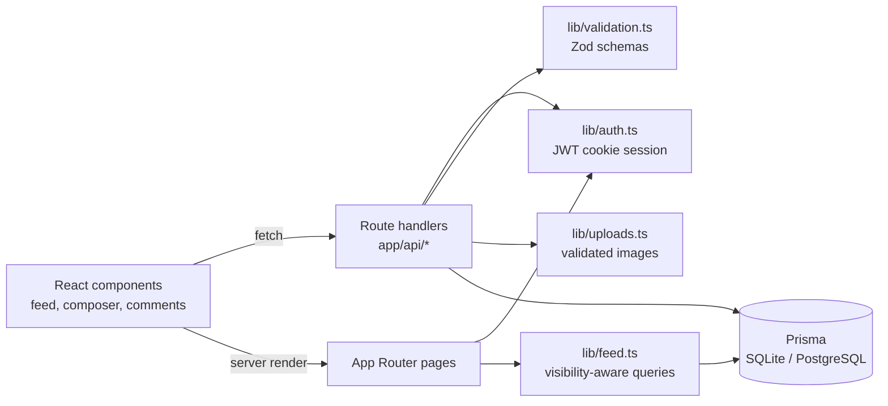

# Social Feed

[](https://github.com/NurMohammad126641/nextjs-social-feed/actions/workflows/ci.yml)


**A full-stack social feed built with the Next.js App Router, TypeScript and Prisma.** It has
secure cookie sessions, public and private posts with image uploads, nested comments and replies,
and likes everywhere, including "liked by" lists. Privacy rules are enforced on the server for
reads and writes, not just hidden in the UI.

## Features

- **Accounts:** registration and login validated with Zod, bcrypt password hashing, and a signed
  JWT session in an `httpOnly`, `sameSite=lax` cookie (`secure` in production).
- **Protected routes:** `/feed` is guarded on the server, and every write API re-checks the
  session on its own.
- **Posts:** text plus an optional image, public or private, newest first.
- **Conversations:** comments and nested replies (one `Comment` model with `parentId`).
- **Reactions:** like and unlike on posts, comments and replies, with "liked by" viewers.
- **Safe uploads:** MIME-type allow-list, 5 MB cap, and server-generated file names.
- **Seed data:** three demo accounts and sample posts for a ready-to-try local setup.

## Tech stack

Next.js 16 (App Router, route handlers) · React 19 · TypeScript · Prisma 6 · SQLite (local) /
PostgreSQL (production) · Zod · bcryptjs · jose · GitHub Actions

## Quick start

```bash
git clone https://github.com/NurMohammad126641/nextjs-social-feed.git
cd nextjs-social-feed
cp .env.example .env        # set AUTH_SECRET to a long random string
npm install
npm run db:setup            # migrations + demo data
npm run dev                 # http://localhost:3000
```

Demo accounts (local seed data only): `jane@example.com`, `alex@example.com` and `sam@example.com`,
all with password `Password123`. Jane has a private post that only she can see. See
[docs/feature-tour.md](docs/feature-tour.md) for a five-minute walkthrough.

## How it works



### Visibility rules

- `PUBLIC` posts are visible to every signed-in user. `PRIVATE` posts are visible only to their
  author.
- The filter runs inside the database query (`lib/feed.ts`), so private rows never reach the
  client.
- The comment, reply and like endpoints check access again, so nobody can interact with a
  private post they can't see.

### Data model

- `User` owns `Post` and `Comment`.
- `PostLike` and `CommentLike` enforce one reaction per user with unique `(targetId, userId)`
  pairs.
- `Comment.parentId` turns comments into threads.
- Indexes cover authorship, visibility and creation time. See
  [`prisma/schema.prisma`](prisma/schema.prisma).

## Project layout

```text
app/                 pages and API route handlers (auth, posts, comments, likes)
components/auth/     login and registration
components/feed/     feed shell, composer, post cards, comment threads, likes
lib/                 auth, feed queries, uploads, validation, Prisma client
prisma/              schema, migrations, seed script
public/assets/       UI stylesheets, fonts and images
docs/                feature tour and test checklist
```

## Commands

```bash
npm run dev          # development server
npm run lint         # ESLint
npm run typecheck    # tsc --noEmit
npm run build        # production build
npm run db:setup     # migrate + seed (local)
npm run db:deploy    # prisma migrate deploy (production)
```

CI runs lint, type-checking, a migration and a production build, plus a
[gitleaks](https://github.com/gitleaks/gitleaks) secret scan, on every push.

## Deploying

The app runs on any Node host that can `next build` and `next start`. A
[`render.yaml`](render.yaml) blueprint is included. For a real deployment:

1. Use PostgreSQL. Set `DATABASE_URL` (an example is in `.env.example`).
2. Set a strong `AUTH_SECRET`.
3. Run `npm run db:deploy` on release.
4. Move uploads to object storage (S3, R2 or Cloudinary) if you run more than one instance.

## Scaling next steps

- Cursor pagination for the feed instead of loading it all at once
- Denormalised or cached reaction counts
- Object storage and a CDN for images
- Background jobs for fan-out, moderation and media processing
- A session table, for server-side revocation

## Credits

The visual layer adapts a third-party HTML/CSS social-media template (Bootstrap, Font Awesome,
Flaticon icons) into React components. The application logic is my own: data model, API, auth,
validation, uploads and feed queries.

## Author

**Nur Mohammad Siddiq**, Data, BI & Automation Engineer.
[LinkedIn](https://www.linkedin.com/in/nur-mohammad-siddiq-9a73931b6) · [GitHub](https://github.com/NurMohammad126641)
